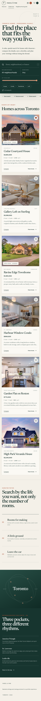

# Parcel & Pine

> A spatial Toronto home-discovery experience with thoughtful filtering, comparison, saved shortlists, and capacity-aware viewing previews.


Parcel & Pine is an original real-estate discovery product designed around a map-and-list workflow rather than a conventional dashboard. The React experience uses an Express/Node service boundary, validated request schemas, and interchangeable static JSON and MongoDB repository adapters. The public GitHub Pages build uses deterministic browser-local persistence; it is not connected to MongoDB and does not contact a brokerage.

## Day-one product foundation

- Responsive spatial discovery with map, list, and split views
- Compound search by text, neighbourhood, price, bedrooms, and property type
- Saved-home drawer with browser-local persistence
- Three-home comparison workspace with monthly-cost and lifestyle details
- Property detail story, room dimensions, highlights, and open-house context
- Validated viewing-plan preview with explicit local-only confirmation
- Loading, no-result, validation, saved-empty, and confirmation states
- Genuine Express routes/controllers/services, Zod validation, error mapping, and MongoDB adapter

## Architecture

```text
React + TypeScript client
  ├─ StaticPropertyRepository → GitHub Pages demo
  └─ Express API → PropertyService → Static JSON or MongoPropertyRepository
```

## Development

```bash
npm ci
npm run validate
npm run qa:browser
```

The full production README, deployment workflow, verified Live Demo link, and additional screenshots are completed on the second workday after the factory validation gate passes.

## Mobile



## Content note

Property records, prices, addresses, viewing times, and confirmations are illustrative and created for this portfolio experience. Photography is licensed separately and documented in [ATTRIBUTIONS.md](ATTRIBUTIONS.md).
