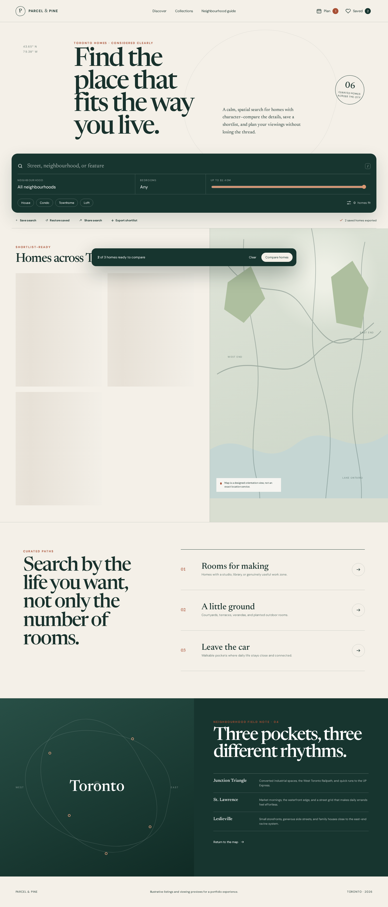

# Parcel & Pine

[](https://miladmo68.github.io/parcel-pine-homes/)
[](#architecture)
[](https://react.dev/)
[](https://www.typescriptlang.org/)
[](.github/workflows/deploy.yml)

An original, spatial Toronto home-discovery product for buyers and renters who want to compare how a place supports daily life—not just scan a conventional listing dashboard. Explore six detailed fictional homes on a responsive map-and-list canvas, shape a search, save and compare a shortlist, export it, and assemble a private viewing plan.

**[Explore the live experience](https://miladmo68.github.io/parcel-pine-homes/)** · **[View the source](https://github.com/miladmo68/parcel-pine-homes)**

## Product highlights

- Map, list, and split discovery modes with linked property selection
- Compound search across text, neighbourhood, property type, bedrooms, and price
- URL-encoded shareable searches plus browser-local save and restore
- Persistent saved-home drawer and CSV shortlist export
- Three-home comparison workspace with cost, space, walkability, and signature details
- Rich property stories, dimensions, highlights, and viewing availability
- Validated viewing-preview flow and persistent planning drawer
- Loading skeletons, no-results recovery, form errors, empty states, and status feedback
- Keyboard `/` search shortcut, focus-trapped dialogs, Escape handling, visible focus, reduced-motion support
- Responsive editorial collections and neighbourhood field guide

## Architecture

Parcel & Pine uses a genuine MERN-oriented service architecture while keeping its public demo free and dependable:

```text
React + TypeScript client
  ├─ StaticPropertyRepository + localStorage → public GitHub Pages demo
  └─ Express routes → controllers → PropertyService
                                ├─ static JSON repositories
                                └─ Mongoose/MongoDB repositories
```

The Express API includes property discovery/detail and viewing-preview routes, Zod validation, service boundaries, error mapping, duplicate protection, and interchangeable static JSON/MongoDB repositories. The GitHub Pages demo intentionally selects deterministic static/browser adapters: **the live site is not connected to MongoDB, does not contact a brokerage, and does not create a real booking.**

## Technology

| Layer | Technology |
|---|---|
| Experience | React 19, TypeScript, semantic HTML, custom responsive CSS |
| API architecture | Node.js, Express, route/controller/service/repository boundaries |
| Data | Mongoose schemas + MongoDB adapters, deterministic static JSON demo adapter |
| Validation | Zod, domain tests, ESLint, TypeScript |
| Browser QA | Playwright desktop and phone journeys |
| Delivery | Vite static production build, GitHub Actions, GitHub Pages |

## Quality checks

```bash
npm ci
npm run validate   # lint + typecheck + domain tests + production build
npm run qa:browser # Chromium desktop/mobile interaction coverage + screenshots
```

Browser QA covers discovery modes, filters, search persistence, URL sharing, CSV export, saved homes, comparison, property detail, form validation, viewing planning, keyboard dialogs, navigation anchors, empty-state recovery, responsive overflow, and real screenshot capture.

## Local setup

```bash
git clone https://github.com/miladmo68/parcel-pine-homes.git
cd parcel-pine-homes
npm ci
npm run dev
```

To exercise the Express service with its secretless static adapter:

```bash
DATA_ADAPTER=static npm run start:api
```

MongoDB integration is available through the repository adapters when an operator supplies a real connection in their own environment; no database or paid service is required for this portfolio demo.

## Mobile experience


## Data and photography

All listings, people, prices, addresses, availability, and viewing previews are illustrative portfolio data—not real inventory or customer activity. Property photography is used under the Pexels license; source records and authorship details are preserved in [ATTRIBUTIONS.md](ATTRIBUTIONS.md).

## Repository

- Source: https://github.com/miladmo68/parcel-pine-homes
- Live Demo: https://miladmo68.github.io/parcel-pine-homes/
- License: original portfolio code; third-party image terms documented separately
